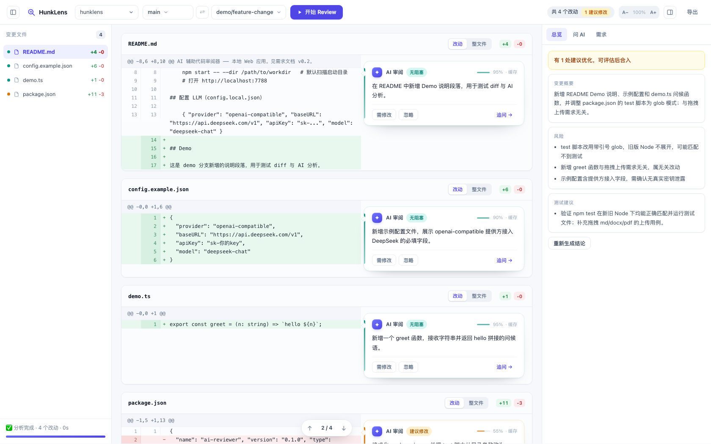
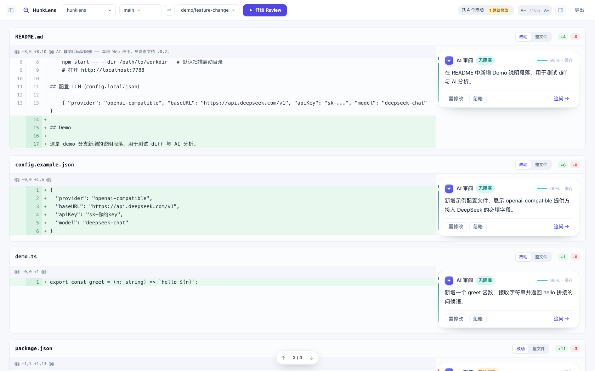
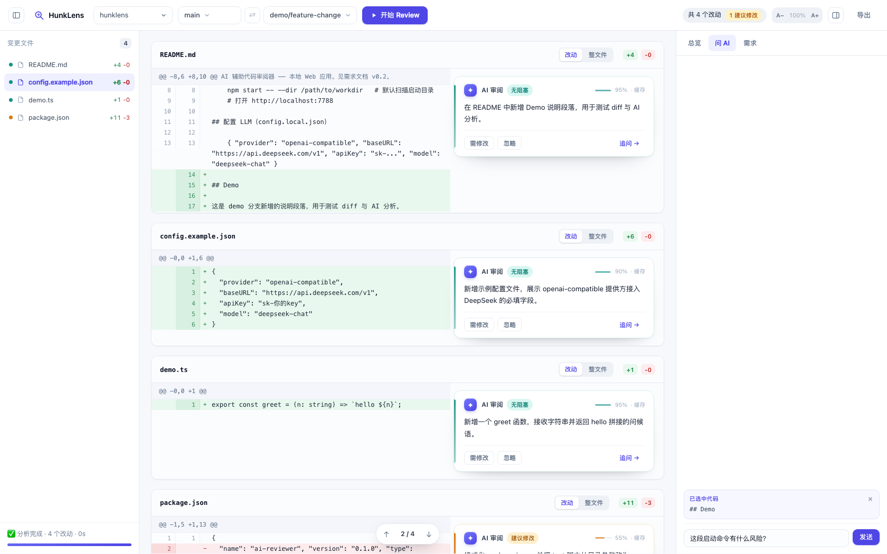
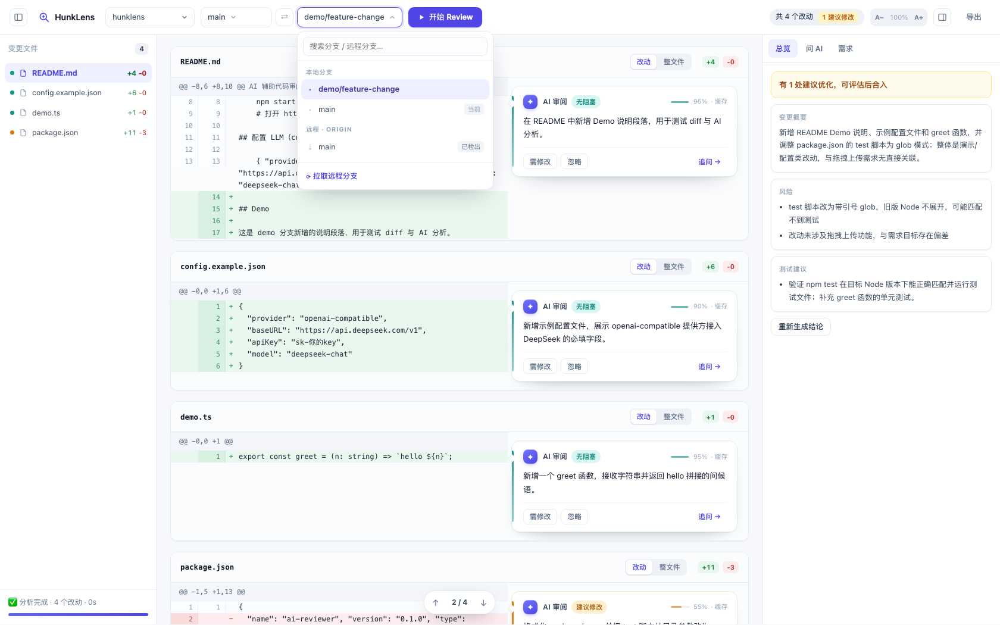
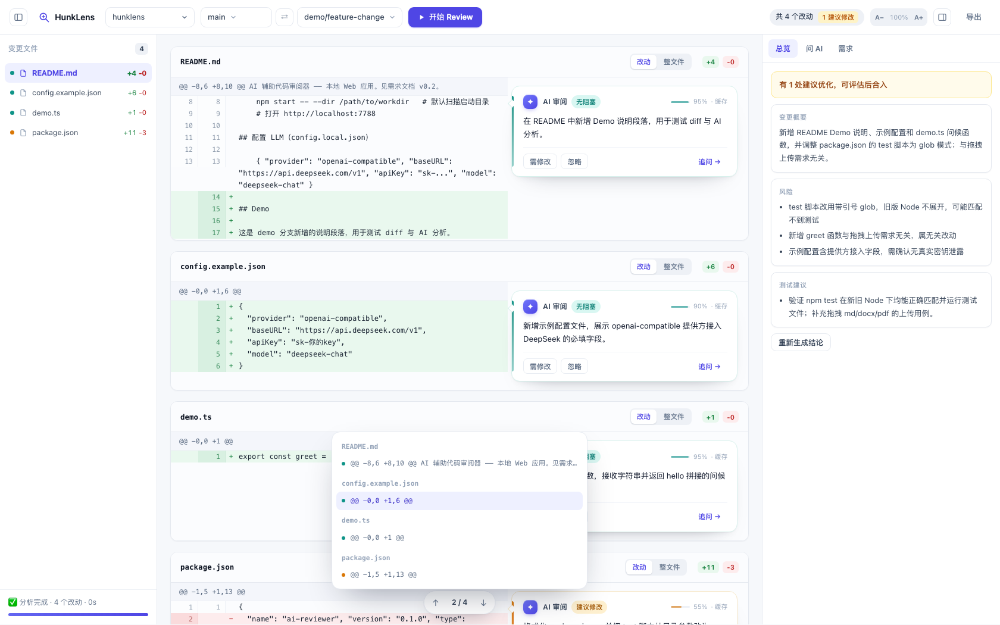
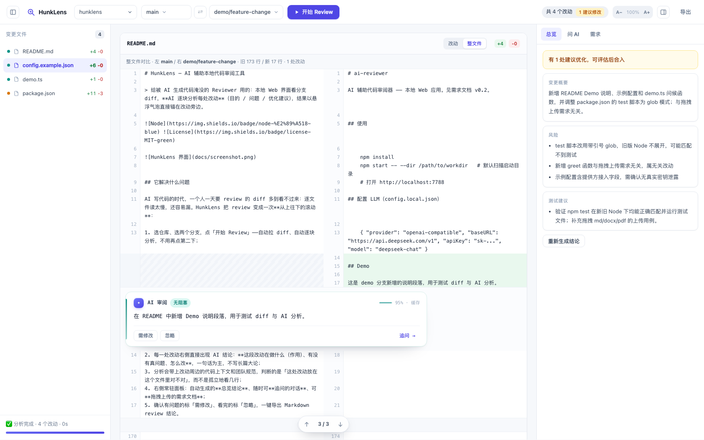
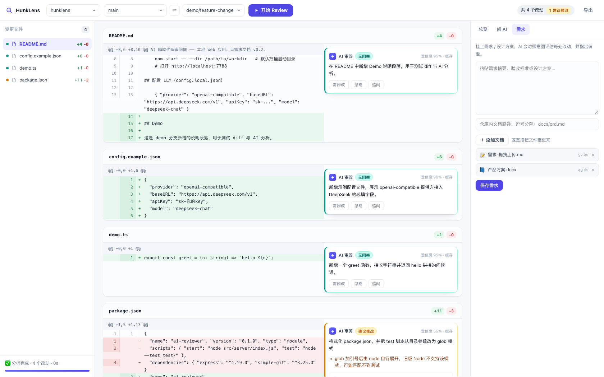

# HunkLens — AI 辅助本地代码审阅工具

> 给被 AI 生成代码淹没的 Reviewer 用的：本地 Web 界面看分支 diff，**AI 逐块分析每处改动**（目的 / 问题 / 优化建议），结果以悬浮气泡直接锚在改动旁边。

 



## 它解决什么问题

AI 写代码的时代，一个人一天要 review 的 diff 多到看不过来：逐文件读太慢，还容易漏。HunkLens 把 review 变成一次**从上往下的滚动**：

1. 选仓库、选两个分支，点「开始 Review」——自动拉 diff、自动逐块分析，不用再点第二下；
2. 每一处改动右侧直接出现 AI 结论：**这段改动在做什么（作用）、有没有真问题、怎么改**，一句话为主，不写长篇大论；
3. 分析会带上改动周边的代码上下文和团队规范，判断的是「这处改动放在这个文件里对不对」，而不是孤立地看几行；
4. 右侧常驻面板：自动生成的**总览结论**、随时可**追问的对话**、可**拖拽上传的需求文档**；
5. 确认有问题的标「需修改」、看完的标「忽略」，一键导出 Markdown review 结论。

所有分析结果落盘缓存，同一段 diff 只分析一次。

## 快速开始

```bash
git clone https://github.com/sdy-17/hunklens.git
cd hunklens
npm install
```

配置你的 LLM（OpenAI 兼容协议即可，DeepSeek / OpenAI / 通义 / 本地 Ollama 均可）：

```bash
cp config.example.json config.local.json
# 编辑 config.local.json：
```

```json
{
  "provider": "openai-compatible",
  "baseURL": "https://api.deepseek.com/v1",
  "apiKey": "sk-你的key",
  "model": "deepseek-chat"
}
```

启动（`--dir` 指定要扫描的代码根目录，其下两级内的 git 仓库都会出现在下拉框里）：

```bash
npm start -- --dir ~/work
```

打开 http://localhost:7788 → 选仓库和分支 → 点「开始 Review」，然后往下滚就行。

也可以直接深链接打开（自动开始分析，适合收藏/分享）：

```
http://localhost:7788/?auto=1&base=main&compare=feature-x
```

## 核心功能

| 功能 | 说明 |
|---|---|
| 一键 Review | 选好分支点一次，自动拉 diff + 逐块 AI 分析 + 生成总览，全程不用再点 |
| 行内 diff | 双行号（旧/新）+ 增删高亮，GitHub 风格；文件侧边栏随滚动高亮当前文件 |
| 整文件对比 | 每个文件可在「改动 / 整文件」间切换：左右对齐整份代码，AI 结论挂在对应改动段下方 |
| 改动导航 | 底部常驻 `2 / 4` 胶囊，点开按文件分组的改动清单，↑↓ 或 `n` / `p` 逐处跳转，滚动自动跟随 |
| 分支对比 | 本地任意两分支 three-dot 对比；下拉可搜索本地/远程分支、一键拉取远程、点远程分支自动建跟踪分支并检出 |
| AI 逐块分析 | 每个 hunk 返回 `{intent, severity, issues[], suggestion, confidence}`，SSE 流式逐个返回，并发 3 |
| 行旁 AI 卡片 | 结论直接贴在改动右侧：一句话讲清「做什么」，最多 3 条真问题，建议可执行；置信度可参考 |
| 选中代码直接问 | 在 diff 里划选任意几行，浮出的「✦ 问 AI」一键带上下文追问，不用手抄代码 |
| 阅读偏好 | 左右两栏都能一键收起（想全屏读 diff 就读 diff），正文字号 A− / A+ 五档可调，偏好本地记住 |
| 上下文感知 | 分析时附带该 hunk 在目标分支文件中前后各 30 行代码，判断质量和意图，而不是只盯几行 diff |
| 总览报告 | 分析完自动生成：合并建议 + 变更概要 + 前 3 个风险 + 测试建议 |
| 需求拖拽上传 | 把 md / txt / docx / pdf / html 直接拖进页面，AI 对照需求评估改动是否符合、指出偏差 |
| 追问对话 | 任意卡片点「追问」、划选代码点「✦ 问 AI」，或直接在右侧提问，自带本次变更与需求上下文 |
| 审阅状态管理 | 「需修改 / 忽略」标记持久化；导出前对 blocker / 未标记项做提醒 |
| 结果缓存 | hunk 级磁盘缓存，重复分析零耗时零费用；提示词版本变化会自动失效 |
| 导出结论 | Markdown 一键下载 |
| 团队规范注入 | 见下节，团队的 review 规范自动进入 AI prompt |

## 阅读体验



- 顶栏左右两个面板图标分别收起文件栏 / AI 面板，两个都收起就是纯 diff 全屏模式；窄屏下它们是抽屉
- 顶栏 A− / A+ 五档调字号（90%–126%），diff 行高、AI 卡片、对话一起缩放
- 在 diff 里划选几行，会浮出「✦ 问 AI」按钮，点了自动把选中的代码带进对话



## 导航 / 分支 / 整文件对比



- **分支**：两个下拉都支持搜索，本地分支与远端分支分组展示，远程分支标「远程」/「已检出」；点远程分支会自动创建本地跟踪分支并检出，底部「⟳ 拉取远程分支」先 fetch 再刷新列表
- **改动导航**：底部胶囊 `↑ 2 / 4 ↓`，点中间数字展开按文件分组的改动清单（带 severity 色点），箭头或键盘 `n` / `p` 逐处跳转，滚动时序号自动跟随当前位置



- **整文件对比**：文件头右上角切换「改动 / 整文件」。整文件模式把两个版本的完整代码左右对齐，未改动段折叠成「展开 N 行未改动」，AI 结论挂在对应改动段下方 —— 判断「这处改动放在整个文件里对不对」时不用来回翻 diff



## 需求文档对照（审阅会话）



每次（仓库 + 分支对）分析是一个独立审阅会话。右侧「需求」页里：

- **直接把文件拖进页面**（md / txt / json / docx / doc / rtf / odt / html，PDF 需 `pip3 install pypdf`），松手即解析成文本挂到会话上，可多个、可单独移除
- 也可以粘贴需求描述 / 验收标准 / PRD 摘要，或填写仓库内文档路径（如 `docs/prd.md`，逗号分隔）
- 挂上之后，每个 AI 卡片、追问、总览报告都会拿到需求背景，prompt 中明确要求**对照需求评估改动是否符合意图、指出偏差**
- 会话按分支对自动隔离与记忆，下次进来还在

## 团队规范（skill 规则注入）

团队 review 规范统一放 `.agent` 目录，HunkLens **递归自动检测布局**并注入每次 AI 审阅的 prompt：

- **全局**：`~/.agent`　**项目**：仓库下 `.agent`
- 任意深度（≤5 层）的 `SKILL.md`（支持 front-matter `name` / `description`）和独立 `.md` 都能识别
- 项目规范排在最前；总注入 8000 字、单条 3000 字，超长自动截断
- 页面顶部徽标显示加载了几条，悬停可看清单

示例：

```
~/.agent/skills/js-style/SKILL.md
---
name: js-style
description: 团队 JS 规范
---
禁止 any；组件一律函数式；提交信息用中文。
```

目录结构不同或要多加目录时，在 `config.local.json` 覆盖：

```json
"rules": { "globalDirs": ["/path/to/team-skills"], "projectDirs": [".claude/skills"], "perProject": true }
```

> 注意：分析结果按 hunk 内容缓存，修改规范文件后请删除 `.cache/analysis` 重新分析（提示词本身升级时会自动更换缓存键）。

## 配置参考

`config.local.json`（不入库）：

| 字段 | 说明 |
|---|---|
| `baseURL` | OpenAI 兼容 API 地址 |
| `apiKey` | 密钥 |
| `model` | 模型名 |
| `rules.globalDirs` | 全局规范目录数组（替换默认 `~/.agent`） |
| `rules.projectDirs` | 项目规范目录数组（替换默认 `.agent`） |
| `rules.perProject` | `false` 关闭项目级规范 |

启动参数：`npm start -- --dir <扫描根目录>`，端口默认 7788（`PORT=xxx` 可改）。

## 架构

```
public/            原生 HTML/CSS/JS 前端（零框架：三栏布局、双行号 diff、SSE 行旁卡片）
src/server/
  index.js         Express API（diff / SSE 分析 / 追问 / 总览 / 需求会话 / 审阅状态 / 导出 / 分支跟踪 / 整份文件）
  scanner.js       扫描根目录下的 git 仓库（深度 2）
  git.js           simple-git 封装（分支 / checkout / fetch / three-dot diff / 读取 ref 文件）
  diffparse.js     unified diff 解析器（丢弃末尾换行产生的幽灵空行）
  analyze.js       hunk 收集（附 ±30 行上下文）、跳过规则、并发池、提示词版本化缓存键
  ai.js            OpenAI 兼容客户端、prompt 构建、严格 JSON 解析（重试 3 次）
  rules.js         团队规范加载（.agent 自动检测 + 长度预算）
  session.js       审阅会话（需求文本 / 文档路径 / 上传附件）
  doctext.js       需求文档文本抽取（文本直读、docx/rtf/html 走 textutil、PDF 走 pypdf）
  cache.js         hunk 级分析缓存（磁盘 JSON）
  reviewstore.js   审阅标记持久化
test/              node:test 单测（18 个）
```

设计参考了 PR-Agent 的 prompt 纪律与 CodeRabbit 的产出形态（总览三段式 / severity 分级 / 路径过滤），但形态完全不同：不做平台机器人，纯本地、任何 git 仓库即开即用。

## 开发

```bash
npm test                          # 全部单测
node src/server/index.js --dir .  # 直接启动
```

## License

[MIT](LICENSE)